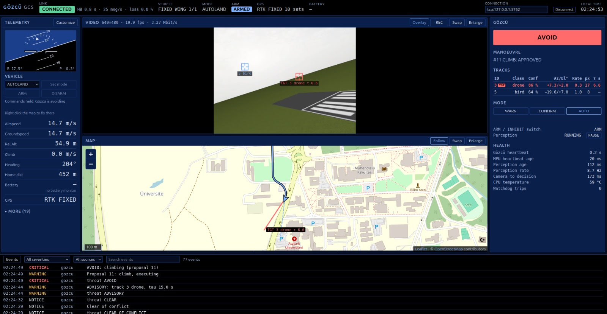
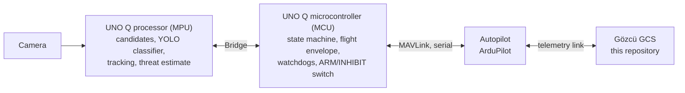
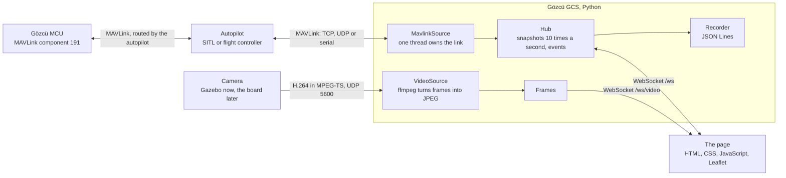

# Gözcü GCS — Ground Station for a Visual Detect-and-Avoid System

A browser-based ground control station for **Gözcü** ("lookout" in Turkish), a visual
detect-and-avoid (DAA) system for small UAVs built on the **Arduino UNO Q**. Gözcü watches
the sky with a camera for traffic that announces itself neither by transponder nor by
ADS-B (other drones, light aircraft, birds) and is designed to steer the UAV clear of it.
This station shows the operator what the aircraft and Gözcü are doing: telemetry, the camera
picture with Gözcü's tracks on it, a map and the threat state. It passes the operator's
decisions to Gözcü and to the autopilot, and records every session for the measurement
campaign.

**Arduino UNO Q Türkiye Innovation Project Competition · 2026** · Python 3.12 · FastAPI ·
pymavlink · vanilla JavaScript · Leaflet



*A simulated encounter: ArduPlane SITL with Gazebo, Gözcü played by the stand-in
`tools/fake_gozcu.py`. Gözcü is avoiding a drone with an approved climb, the drone is marked
on the camera picture and drawn on the map as a bearing ray, and the station holds the
operator's own commands to the autopilot until the avoidance is over. The stand-in makes its
tracks up, so the marks point at empty sky.*

## What it does

Gözcü's software runs on the aircraft: the UNO Q's processor finds and tracks objects in
the camera picture, and its microcontroller decides whether to warn or to avoid. The ground
station is the operator's window into that, and the operator's way to take part in it:

1. **Connect.** The station links to the autopilot over TCP, UDP or a serial telemetry
   radio, and shows the link's health, the vehicle's mode and arm state, GPS and battery.
2. **Watch.** Telemetry widgets, an attitude indicator, the map with the vehicle's track,
   and the camera picture.
3. **Get warned.** When Gözcü reports an ADVISORY, the threat badge turns amber, the
   threatening track is marked on the video and drawn on the map along its bearing.
4. **Decide.** In CONFIRM mode Gözcü proposes a manoeuvre, and the operator approves or
   rejects it before a countdown runs out, by holding a button down.
5. **Stand back.** In AVOID, Gözcü's microcontroller has the autopilot fly the manoeuvre.
   Until it is over, the station holds the operator's own commands to the autopilot, so that
   nothing from the ground works against it.
6. **Analyse.** Every session goes to a JSON Lines file, and the camera stream to a video
   file if asked, for the measurement campaign.

It is deliberately not a general-purpose ground station. There is no mission planning, no
parameter editor and no geofence editing; Mission Planner and QGroundControl remain for
those. It focuses on three things: telemetry monitoring, the Gözcü panel, and recording.

## The Gözcü system

This repository is the ground station. Gözcü's onboard software (perception, the
microcontroller firmware and the link between them) is developed separately by the other
member of the team. The whole system, as designed:



- **Principle: "AI suggests, the real-time core decides"** (run-time assurance, Simplex
  architecture). Perception may be wrong; the microcontroller checks every proposal against
  the flight envelope and is the only part of Gözcü that commands the autopilot.
- **MPU** (Qualcomm QRB2210, Debian, Python): candidate points from a sky mask and
  morphology, small crops around them, a small YOLO classifier (aircraft, drone, bird,
  background), Kalman tracking, compensation of the vehicle's own rotation, and a threat
  estimate from the bearing rate and how fast the object grows in the picture: the time to
  collision, τ.
- **MCU** (STM32U585, Zephyr): a TCAS-like state machine, CLEAR → ADVISORY → AVOID → CLEAR
  OF CONFLICT; flight-envelope checks; two watchdogs ("the processor is silent" and
  "perception is stale"); Gözcü's only MAVLink link to the autopilot; and a physical
  ARM/INHIBIT switch wired to it.
- **Modes:** WARN only warns and records. CONFIRM proposes a manoeuvre and waits for the
  operator's approval on the ground station. AUTO carries the manoeuvre out by itself.
- **Targets to measure:** perception at 8 Hz or more; camera-to-decision latency under
  250 ms in 95 % of measurements (the microcontroller lights an LED, the camera sees it);
  safe mode within 200 ms of the processor falling silent and within 500 ms of the camera
  freezing; every proposal outside the flight envelope refused; and the minimum separation
  from intruders with Gözcü on and off.
- **Test method:** hardware in the loop. The board runs on a desk and flies the simulated
  aircraft: ArduPilot SITL with Gazebo ↔ mavlink-router ↔ USB-TTL adapter ↔ microcontroller.

The ground station and Gözcü agree on a written message contract,
[docs/message_contract.md](docs/message_contract.md), so that each side can be built and
tested without the other.

## Features

### Link and telemetry
- Connects over TCP, UDP or serial (a telemetry radio). The link can be changed or closed
  from the top bar while the station runs; the box suggests the links used before, the
  serial ports present and the usual SITL ports.
- **Link health:** heartbeat age, message rate, and packet loss counted from gaps in the
  sequence numbers.
- **"Transport open" is kept apart from "telemetry fresh".** A late heartbeat shows LINK
  LOST after 3 s, but the link is reopened only when the transport itself fails. In SITL
  lockstep a paused Gazebo slows the heartbeats without breaking anything.
- Mode and arm state come only from the autopilot's heartbeat, never from those of
  MAVProxy, other ground stations or Gözcü.
- Asks the autopilot for the message rates it needs (ATTITUDE at 10 Hz, position and
  VFR_HUD at 5 Hz, …), and asks again after an autopilot reboot.
- **One field registry:** every value is one table row, with its source message and field,
  unit conversion, precision, staleness and warning limits. The widgets, the message rates
  and the recording are all built from it, so a new widget is a new row.
- Eight pinned widgets and nineteen more, chosen per browser. A stale value turns grey and
  shows its age; a value past a limit is coloured and tagged WARN or CRIT.
- An attitude indicator.
- **Event log:** the autopilot's texts (long ones reassembled, Turkish characters intact),
  mode and arm changes, link and Gözcü events; filterable by severity, source and text.

### Map
- OpenStreetMap tiles with their attribution, the vehicle turned to its heading, its track,
  home, a scale, and Follow.
- Without tiles (offline, or none configured) the vehicle and its track are drawn on a grid
  that keeps distances readable.
- **Gözcü's tracks as rays** from the vehicle along their bearing, since Gözcü knows the
  direction of a track but not its range. The target's ray is in its threat colour and
  labelled.
- A right-click opens **Fly here** (see below).

### Video
- The camera stream, H.264 in MPEG-TS over UDP 5600 as Gazebo's camera sends it, is turned
  into JPEG frames by ffmpeg and sent on a WebSocket of its own. A slow browser skips
  frames; a frame never delays telemetry.
- Shows the resolution, frame rate and bit rate, and says why there is no picture: no
  signal, frozen, ffmpeg missing, port taken.
- **Gözcü's tracks on the picture:** a reticle and a label for each track, the target in its
  threat colour, placed from the camera's horizontal field of view. "Overlay" hides them.
- **REC** records the stream exactly as it arrives, without re-encoding.

### Gözcü panel
- **Threat badge:** CLEAR neutral, ADVISORY amber, AVOID red, CLEAR OF CONFLICT green;
  "GÖZCÜ SILENT" when its heartbeat stops.
- A safe-mode banner that names the fault.
- **The proposed manoeuvre** with a countdown. APPROVE and REJECT appear only while a
  proposal waits for the operator.
- **Tracks table:** id, class, confidence, azimuth and elevation, bearing rate, apparent
  size and τ, the target tagged TGT.
- Gözcü's mode (WARN, CONFIRM, AUTO), perception run and pause, and the ARM/INHIBIT switch,
  read only: the switch on the board has the authority.
- **Health:** Gözcü's heartbeat, how long the processor has been silent, the age of the
  newest perception result, perception rate, latency, temperature and watchdog trips, each
  against its limit.
- A message from Gözcü that the contract does not define, or another contract version, is
  reported once in the event log, for the firmware's developer.

### Commands
- **Every command button has to be held down for 0.6 s;** a stray click or tap sends
  nothing. A held button fills up; letting go early cancels.
- **To Gözcü:** change its mode, approve or reject a proposal, run or pause perception.
  These go only to Gözcü's MAVLink component, never to the autopilot. A decision names the
  proposal it answers, so a late click is refused rather than misapplied.
- **To the autopilot:** set the flight mode (FBWA, CRUISE, LOITER, RTL, AUTO, TAKEOFF,
  GUIDED, AUTOLAND), arm and disarm, and **Fly here**: a right-click on the map, an altitude
  (the vehicle's own is offered, at least 50 m), and a held button send the vehicle there
  in GUIDED. The point stays marked while it goes there.
- Each destination has one command in flight at a time. A command without an answer is sent
  again at most twice, and its outcome, with the reason for a refusal, shows beside its
  buttons and in the event log.

### Recording
- Every run goes to a JSON Lines file named after its start time: a header that describes
  the session, then every event, and twice a second the value of every field (`null` when
  unknown or stale), with Gözcü's values and tracks once Gözcü has been heard. About 4 MB an
  hour.
- REC writes the video beside it as `<start time>_video.ts`.

### Running it
- **`./start.sh`** installs the station on its first run and starts it on every run.
- **A desktop launcher** (`./start.sh --install-launcher`) opens the station in a window of
  its own without an address bar, and stops it when the window closes.
- **The page notices when it and the station do not belong together,** e.g. when the
  station was not restarted after an update, and says what to do.
- A station that cannot listen on its address says why at once, before it starts anything.

### Testing without hardware
- `tools/fake_gozcu.py` plays Gözcü's microcontroller and follows the message contract,
  with scenarios from a full encounter to safe mode.
- `tools/fake_autopilot.py` stands in for the autopilot in tests.
- `tools/ui_check.py` uses the page in a real browser as an operator would, against these
  stand-ins and a test camera stream: 24 checks in about half a minute.
- `sim/start_sim.sh` starts the simulation the station is tested against.

## Safety

- Every command button has to be held down for 0.6 s: a stray click or tap sends nothing.
- One command at a time goes to Gözcü, and one to the autopilot. Each is sent again at most
  twice while unanswered, and what became of it shows beside its buttons and in the event log.
- Gözcü's commands go only to Gözcü's component: the MCU decides, the station only asks.
- The station never sends an avoidance manoeuvre; that is Gözcü's job. While Gözcü avoids,
  or one of its proposals waits for an answer, the operator's commands to the autopilot are
  held.
- The autopilot checks every command as it checks any ground station's; nothing is forced.
  ArduPlane runs its pre-arm checks before arming and refuses a disarm from the ground while
  flying. The RC transmitter remains the way to take over.
- Every coloured state is also written out: amber for caution, red for danger, green only
  for what is well (link up, clear of conflict).
- Only the station's own page may use it: a website open in another tab cannot send it
  commands.

## How it is built



1. **One thread owns the link.** pymavlink's sending is not thread-safe, so a single thread
   reads, sends the heartbeat and the rate requests, watches the link and reopens it. What
   it learns leaves the thread only as plain data.
2. **Snapshots, not streams.** Ten times a second the whole state goes to every browser as
   one message; events go the moment they happen. A slow browser may skip snapshots, since
   only the newest matters, but it receives every event.
3. **Video on a connection of its own.** A frame of tens of kilobytes never delays telemetry,
   and only the newest frame waits for each browser.
4. **A table instead of code.** The field registry drives the widgets, the message rates,
   staleness and the recording.
5. **The contract comes first.** Gözcü's messages were defined in
   [docs/message_contract.md](docs/message_contract.md) before the panel was written, and a
   stand-in follows the contract, so the ground station and the firmware can be built and
   tested apart.
6. **Standard MAVLink messages only.** `NAMED_VALUE_INT/FLOAT`, `STATUSTEXT`, `COMMAND_LONG`
   and `COMMAND_ACK` need no custom dialect, and MAVProxy and QGroundControl show them as
   they are.
7. **The data source can be replaced.** The server only knows "a telemetry source": a MAVLink
   link today, a source reading the UNO Q's Bridge later.
8. **No build step.** Plain HTML, CSS and JavaScript modules, so the same files can later be
   served from the board itself.

### The message contract

| From | Message | What it carries |
|---|---|---|
| Gözcü | `HEARTBEAT`, 1 Hz, component 191 | presence; the autopilot learns where to route commands |
| Gözcü | `NAMED_VALUE_INT/FLOAT`, 2 Hz | state, mode, switch, perception, faults, health, the proposal |
| Gözcü | `NAMED_VALUE_INT/FLOAT`, up to 4 Hz | track frames of up to three tracks, closed by `G_NTRK` |
| Gözcü | `STATUSTEXT` | events for the operator's log |
| Station | `COMMAND_LONG`, `MAV_CMD_USER_1` | mode, decision on a proposal (with its id), perception |
| Gözcü | `COMMAND_ACK` | the result, and why a command was refused |

Version 1 is a draft, to be agreed with the firmware; the full text, with codes, units,
timing and bandwidth, is in [docs/message_contract.md](docs/message_contract.md).

### Measured

- **Video**, with the Gazebo camera (640x480, about 19 fps, 0.9 Mbit/s) on an i7-13650HX:
  ffmpeg needs about 12 % of one core to convert every frame (8 % with `max_fps = 10`). A
  frame reaches the browser about 100 ms after its first packet arrives, all but 4 ms of
  that because MPEG-TS completes a frame only when the next one begins. Recording the video
  costs no measurable CPU.
- **Recording:** about 4 MB an hour.
- **Gözcü's traffic:** at most about 3.6 kB/s (state, a proposal and three tracks at 4 Hz),
  so the link between the microcontroller and the autopilot should run at 115200 baud or
  more.

## Development process

The station was built step by step from the roadmap in the project brief. Each step was
designed, implemented and verified before the next one began, and is one commit or a few in
this repository.

| Step | Date | What it delivered |
|---|---|---|
| 0–1 | Oct 27–29, 2026 | Checking the environment; a console link check (`tools/link_check.py`) |
| 2 | Oct 29 | Telemetry core (settings, field registry, state, MAVLink source), the web server and its WebSocket stream, session recording |
| 3–4 | Oct 29 | The page layout, the top bar, telemetry widgets, the attitude indicator, the event log and its filters |
| 5 | Oct 29 | The map: OpenStreetMap tiles, track, home, Follow |
| 6 | Oct 29 | The video panel: the camera stream as JPEG frames, REC |
| 7 | Oct 30–31 | The message contract, the Gözcü panel, commands to Gözcü with acknowledgements, the stand-in Gözcü, tracks on the video and the map |
| 8 | Oct 31 | The connection box, commands to the autopilot, the browser check tool, the README |
| 9 | Oct 31 | One-command install and start, the update notice, the desktop launcher, the simulation setup |

**How each step was verified**
- **Unit and integration tests:** 266 run by pytest, among them end-to-end tests of the
  MAVLink source against a stand-in autopilot; one of them runs the browser code's 49 unit
  tests with Node's test runner. ruff for linting.
- **In a real browser:** headless Firefox driven over WebDriver BiDi, pressing and holding
  buttons, right-clicking the map, typing, and counting the pixels of the marks drawn on
  the picture. This is now `tools/ui_check.py`.
- **Against the simulation:** ArduPlane SITL with Gazebo for telemetry, video and the map;
  Gözcü's traffic and commands routed by the real autopilot from SITL's second serial port;
  arming, takeoff and AUTOLAND flown from the station.

**What building it taught us**
- Gazebo's camera sends H.264 in MPEG-TS, not RTP as first assumed, and only after its
  streaming has been switched on.
- The camera's H.264 header claims 5 fps while about 19 arrive. Left alone, ffmpeg slows
  everything down to 5 fps; frames now pass through with their own time stamps.
- Most of the video latency is MPEG-TS itself: a frame is complete only when the next one
  starts. Measured, not guessed: 96 of about 100 ms.
- A late heartbeat in SITL lockstep is not a broken link. Reopening the link on every late
  heartbeat would make things worse, so the two are told apart.
- The autopilot forwards Gözcü's commands only once it has heard Gözcü's heartbeat; this was
  checked in ArduPilot's routing code and became a rule of the contract.
- pymavlink turned Turkish characters in the autopilot's texts into "?", so the station
  decodes them itself.
- A browser kept an old copy of one script and mixed it with a new one, which broke a panel.
  The station now makes browsers check every file, each panel fails on its own, and the
  page says when it and the station no longer match.

## Getting started

### Requirements
- Ubuntu 24.04 (Python 3.12), with `sudo apt install python3-venv ffmpeg`.
- Firefox or Chromium.
- For the simulation: ArduPilot SITL, Gazebo Harmonic with ardupilot_gazebo, and
  SITL_Models with this project's changes; [sim/README.md](sim/README.md) has the steps.
- Optional: Node.js 22.7 or newer, for the browser code's unit tests.

### Quick start

```bash
git clone https://github.com/EmirAkay-007/gozcu-gcs.git && cd gozcu-gcs
./start.sh                                     # then open http://127.0.0.1:8000
```

The first run installs the station into `.venv` (this needs the internet), and so does the
first run after `pyproject.toml` changes; every run starts it, connected to SITL at
`tcp:127.0.0.1:5762`. `./start.sh` takes the options of `python -m gcs`, e.g.
`./start.sh --conn udpin:0.0.0.0:14551`, or `--port` for another HTTP port. After an
update, restart the station and reload the page; the page says so at the top when the two
no longer belong together.

### Connecting
- **SITL:** `tcp:127.0.0.1:5762` (the default; SITL serves one client per port) or
  MAVProxy's output, `udpin:0.0.0.0:14551`.
- **A telemetry radio** plugged in by USB: `--conn /dev/ttyUSB0,57600` (its port and baud
  rate). On Linux the user must be in the `dialout` group.
- While the station runs, the connection box in the top bar changes or closes the link
  (hold the button: a working link's telemetry stops).
- Gözcü needs no link of its own: the autopilot passes its reports on from the port the
  microcontroller is connected to, over any of these links.

### Simulation and the stand-in Gözcü

```bash
sim/start_sim.sh                               # Gazebo, the camera stream, SITL and MAVProxy
./start.sh                                     # the station, on tcp:127.0.0.1:5762
.venv/bin/python -E tools/fake_gozcu.py        # Gözcü's MCU, on SITL's second port, 5763
```

`fake_gozcu.py --help` lists its scenarios: a full encounter every 30 s, clear sky, the
processor silent, perception stale, Gözcü silent, or all of them in turn.

### Desktop launcher
`./start.sh --install-launcher` adds a **Gözcü GCS** launcher to the menu and to the
desktop. It starts the station, unless one runs already, and opens it in a window of its
own without an address bar (Chromium's; Firefox's if there is no Chromium); closing the
window stops the station it started. Having no terminal, it writes what the station says to
`~/.local/state/gozcu-gcs/station.log` and tells why it could not start in a desktop
notification. To remove it, delete `gozcu-gcs.desktop` from `~/.local/share/applications`
and from the desktop.

### Settings
Settings come from `config.toml` when it exists; start from a copy of
[config.example.toml](config.example.toml), which lists every setting with its default.
`--conn` and `--port` override it. The sections:
- `[mavlink]`: the connection, the station's own MAVLink ids, the autopilot's and Gözcü's
  component ids, when the link counts as lost, whether to ask for message rates.
- `[server]`: the address and port of the page.
- `[recording]`: on or off, the folder, values per second.
- `[map]`: the tile server and its attribution. OpenStreetMap's servers must not be
  bulk-downloaded or used offline; for offline use, point `tile_url` at a tile server of
  your own, or leave it empty for the grid.
- `[video]`: on or off, the address to receive on, a frame-rate limit for the browser, the
  camera's horizontal field of view.

Recordings go to a `Gözcü GCS logs` folder on the desktop unless `[recording] directory`
says otherwise.

### Development

```bash
.venv/bin/python -E -m pytest                  # unit and integration tests
.venv/bin/python -E -m ruff check .            # lint
.venv/bin/python -E tools/link_check.py        # check the MAVLink link to SITL
.venv/bin/python -E tools/ui_check.py          # use the page in a real browser
```

`-E` makes Python ignore `PYTHONPATH`. Where ROS is sourced, that variable points at ROS's
Python packages, which would otherwise leak into this project's environment.

The browser code needs no build step. With Node.js 22.7 or newer installed (on `PATH` or
through nvm), pytest also parses every script in `web/js` and runs the unit tests in
`tests/js`; without Node.js those two tests are skipped. To run only the browser tests:
`node --test tests/js/*.test.js`. The video tests run a real ffmpeg and are skipped without
it.

`tools/ui_check.py` starts the station with stand-ins for the vehicle, Gözcü and the camera,
opens the page in headless Firefox and uses it as an operator would: it holds the buttons,
right-clicks the map, types an altitude, and lists what worked. `--screenshots DIR` keeps a
few pictures. It needs Firefox, and ffmpeg for the video checks. Its ports are free ones, the
map loads no tiles and nothing is recorded, so it can run beside the simulation and a
running station.

## Project structure

```
gcs/                         the station, in Python
├── __main__.py              python -m gcs [--config] [--conn] [--port] [--window]
├── config.py                settings: defaults, config.toml, command line
├── server.py                FastAPI: the page, the WebSockets, requests from browsers
├── sources/
│   ├── base.py              what a telemetry source provides
│   └── mavlink_source.py    the MAVLink link, its state, and the routing of commands
├── fields.py                the field registry: one row per value
├── state.py                 the newest value of every field, its age, snapshots
├── heartbeat.py             telling the autopilot apart from other components
├── intervals.py             message rate requests
├── link_stats.py            packet loss and message rates
├── statustext.py            reassembling long texts
├── gozcu.py                 Gözcü's reports, as the message contract defines them
├── commands.py              the MAVLink command protocol: one in flight, sent again, acknowledged
├── gozcu_commands.py        commands to Gözcü
├── vehicle_commands.py      commands to the autopilot
├── video.py                 the camera stream to JPEG frames, and its recording
├── recorder.py              the session recording, JSON Lines
├── units.py                 unit conversions
├── mav.py                   pymavlink set-up, connection strings, serial ports
└── window.py                the station in a window of its own (the launcher)
web/                         the page: no build step
├── index.html
├── css/app.css
├── icon.svg
├── js/                      one module per part: map.js, video.js, gozcu.js, vehicle.js, …
└── vendor/leaflet/          Leaflet 1.9.4
docs/message_contract.md     the contract between Gözcü and the ground station
tools/                       link_check, fake_gozcu, fake_autopilot, ui_check
sim/                         start_sim.sh, the changes to SITL_Models, the QR target model
tests/                       pytest; tests/js for the browser code
start.sh                     install and start in one command
config.example.toml          every setting, with its default
THIRD_PARTY_NOTICES.md       what comes from elsewhere, and its license
```

## When something is wrong

The station says what it knows in the event log and on the panel concerned. The usual cases:

- **`gcs: cannot listen on http://127.0.0.1:8000`**: a station is already running there (it
  says so) or another program has the port. Use or stop that one, or start with `--port`.
- **NO VEHICLE, "no MAVLink data on tcp:127.0.0.1:5762 yet"**: another program holds that
  port (SITL serves one client per port), or the simulation is paused. Close the other
  program, or choose another link in the connection box.
- **Video NO SIGNAL**: nothing arrives on UDP 5600; Gazebo's camera sends only once its
  streaming is enabled. **ERROR "another program is receiving it"**: another station or a
  video player has the port.
- **"cannot open /dev/ttyUSB0,57600: … Permission denied"**: add the user to the `dialout`
  group (`sudo usermod -aG dialout $USER`), then log in again.
- **A command "not sent", or "Commands held: …"**: the reason given is why; see Safety.
- **A notice at the top of the page**: the page and the station do not belong together;
  do what it says (restart the station, or reload the page).

## Known limitations

The station works against the simulation, but it has not met the real board yet. The
current shortcomings, stated openly:

**Gözcü and the board**
- Everything about Gözcü has been tested against the stand-in `tools/fake_gozcu.py`, which
  follows the message contract. The contract itself is still a draft until the firmware is
  written against it.
- The hardware-in-the-loop chain (mavlink-router between SITL, the station and the board's
  serial adapter) is described but not set up yet.
- Track classes, Gözcü's camera, and how the board sends video depend on decisions still to
  be made on the board and in model training.

**Commands to the autopilot**
- Mode changes, arming, takeoff and AUTOLAND have been tried in SITL. "Fly here" has so far
  been tested only against a stand-in autopilot, and ArduPlane's refusal of an in-flight
  disarm only read in its source code.
- Flight modes are sent by ArduPlane's numbers, so other ArduPilot vehicles are refused.
- "Fly here" takes altitudes of 20 to 500 m above home and knows nothing of the terrain.

**Video and map**
- The station receives only H.264 in MPEG-TS over UDP, as Gazebo's camera sends it. There
  is no RTP yet, and no mode that shows only the frames around an event.
- The map needs the internet for its tiles; offline it shows a grid, unless a tile server of
  your own is set.

**Security**
- There is no login. By default the station listens only on the computer it runs on, and
  it refuses WebSockets from other websites, but anyone who can open its page can send
  commands. Before it is served over Wi-Fi from the board, it needs an operator lock.

**Measurements**
- The recording holds the values twice a second (configurable up to ten). The safe-mode
  targets of 200 and 500 ms cannot be measured from the ground, because the link adds its
  own delay; the microcontroller has to measure them itself.
- There is no report tool yet that turns a recording into the target measurements.

**Platform**
- Developed and tested on Ubuntu 24.04 with Firefox and Chromium. The desktop launcher is for
  GNOME. Other systems have not been tried.

## Roadmap

**Without the board**
- Rehearse the hardware-in-the-loop chain with the stand-in Gözcü on a virtual serial port,
  so that on the day only the port name changes.
- A contract check, `tools/hitl_check.py`: whether what answers as component 191 follows the
  contract (heartbeat, version, values and their rates, acknowledgements, refusals).
- A report tool, `tools/report.py`: the target measurements from a recording (perception
  rate, latency against 250 ms, safe-mode events, refused proposals).
- Replay of a recording in the interface, for analysis and demonstrations.
- The station's processor and memory use, ahead of running it on the board.

**With the board and the trained model**
- Hardware-in-the-loop tests with the real microcontroller (November 16–29, 2026).
- Version 2 of the contract: the trained model's classes, and safe-mode timing measured by
  the microcontroller.
- Video from the board's camera: a low-resolution preview, or only the frames around events.
- A data source that reads the UNO Q's Bridge, and serving the interface from the board
  through Arduino App Lab's WebUI, behind an operator lock.
- The measurement campaign: minimum separation from intruders with Gözcü on and off.

## Team

- **Hüseyin Emir Akay** ([@EmirAkay-007](https://github.com/EmirAkay-007)), Computer
  Engineering, Atatürk University: the ground station, this repository.
- Gözcü's onboard side (the board, the camera, the Bridge and the microcontroller firmware)
  is developed by the other member of the team.

Built on the work of others: ArduPilot and its SITL, Gazebo and ardupilot_gazebo, pymavlink,
FastAPI, Leaflet, ffmpeg, and the map data of OpenStreetMap's contributors.

## License

Released under the [MIT License](LICENSE): free to use, modify and distribute as long as the
copyright notice is kept. Third-party components keep their own licenses, listed in
[THIRD_PARTY_NOTICES.md](THIRD_PARTY_NOTICES.md).
